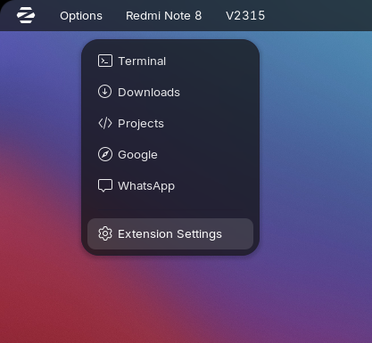
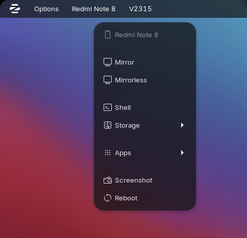
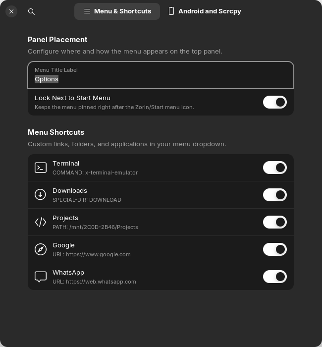
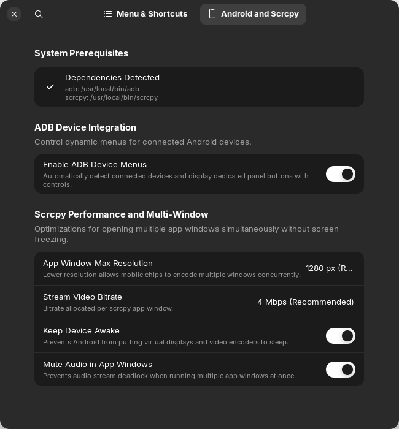

<div align="center">

# Quick Menu & ADB Manager

**A sleek, native GNOME Shell top panel launcher & automated multi-window Android device manager.**

[](https://extensions.gnome.org/extension/11552/quick-menu-adb-manager/)
[](https://github.com/Byte-Craftsman-Alpha/QuickMenu-GNOME-Extension/releases/latest)
[](https://github.com/Byte-Craftsman-Alpha/QuickMenu-GNOME-Extension/actions)
[](LICENSE)
[-orange.svg?style=flat-square&logo=linux)](https://www.kernel.org)
[](https://extensions.gnome.org/extension/11552/quick-menu-adb-manager/)

<p align="center">
  <a href="#overview">Overview</a> •
  <a href="#visual-tour">Visual Tour</a> •
  <a href="#key-features">Key Features</a> •
  <a href="#system-prerequisites">Prerequisites</a> •
  <a href="#recommended-android-settings">Android Settings</a> •
  <a href="#installation-guide">Installation</a> •
  <a href="#preferences--configuration">Preferences</a> •
  <a href="#contributing">Contributing</a>
</p>

---

</div>

## Table of Contents

- [Overview](#overview)
- [Visual Tour](#visual-tour)
- [Key Features](#key-features)
  - [Custom Quick Launch Menu](#1-custom-quick-launch-menu)
  - [Dynamic ADB Device Management](#2-dynamic-adb-device-management)
  - [Multi-Window App Streaming with scrcpy](#3-multi-window-app-streaming-with-scrcpy)
  - [Native Libadwaita Preferences](#4-native-libadwaita-preferences)
- [System Prerequisites](#system-prerequisites)
- [Recommended Android Settings](#recommended-android-settings)
- [Installation Guide](#installation-guide)
  - [Option A: Via GNOME Extensions Website (Recommended)](#option-a-via-gnome-extensions-website-recommended)
  - [Option B: From GitHub Release (.zip)](#option-b-from-github-release-zip)
  - [Option C: From Source (Makefile)](#option-c-from-source-makefile)
- [Preferences & Configuration](#preferences--configuration)
  - [Tab 1: Menu & Shortcuts](#tab-1-menu--shortcuts)
  - [Tab 2: Android & Scrcpy](#tab-2-android--scrcpy)
  - [Tab 3: About & Maintenance](#tab-3-about--maintenance)
- [Repository File Structure](#repository-file-structure)
- [Contributing](#contributing)
- [Changelog](#changelog)
- [License](#license)

---

## Overview

**Quick Menu & ADB Manager** is an open-source GNOME Shell extension built for developers, power users, and multitaskers. It combines a customizable top-panel quick launcher for applications, files, directories, and web bookmarks with a background Android ADB daemon monitor that surfaces connected mobile devices directly on the panel bar.

With deep `scrcpy` virtual-display integration, you can stream and interact with multiple individual Android applications in standalone, resizable desktop windows—without locking or occupying your entire mobile screen.

---

## Visual Tour

| Quick Launcher Dropdown | Dynamic ADB Device Menu |
| :---: | :---: |
|  |  |
| *Top panel quick menu with customizable shortcuts & system actions.* | *Auto-detected connected phone with mirroring, shell & app controls.* |

<br/>

| Preferences: Shortcuts & Panel | Preferences: Android & Streaming |
| :---: | :---: |
|  |  |
| *Add, edit, reorder shortcuts and adjust panel alignment in Libadwaita.* | *Dependency auto-detection, resolution bounding, bitrate & keep-awake.* |

---

## Key Features

### 1. Custom Quick Launch Menu
- **Multi-Action Items**: Launch terminal binaries (`command`), open folders/files (`path`), navigate to websites (`url`), or resolve standard XDG user folders (`special-dir`: Downloads, Documents, Pictures).
- **Symbolic UI**: Clean macOS/iOS styled monochrome symbolic icons (`*-symbolic`) that match any GTK shell theme.
- **Panel Placement Options**: Pin the button next to the primary application launcher (e.g., Zorin Menu) or position it freely in the `Left`, `Center`, or `Right` panel sections.
- **Live Rebuilding**: Modifications made in settings take effect immediately on the panel without reloading GNOME Shell.

### 2. Dynamic ADB Device Management
- **Zero-Configuration Detection**: Automatically detects USB and TCP/IP connected Android devices via background ADB polling.
- **Dedicated Device Indicators**: Each device gets its own panel button displaying its model name (e.g. `Redmi Note 8`, `Pixel 7`).
- **One-Click Screen Control**:
  - **Mirror**: Standard low-latency full screen mirror.
  - **Mirrorless**: Turn off the device display while maintaining full desktop interaction (`scrcpy -S`).
- **Terminal Shell & Storage**: Direct terminal ADB root/user shell and `/sdcard` navigation.
- **Quick Utilities**: Instant desktop screenshots saved straight to your `~/Pictures` folder, plus one-click device reboot.

### 3. Multi-Window App Streaming with scrcpy
- **Independent Floating Windows**: Launches specific Android applications in separate, resizable windows via `scrcpy --new-display`.
- **Parallel App Multitasking**: Open multiple Android apps simultaneously (e.g. WhatsApp, Spotify, Settings) side by side.
- **Freeze & Deadlock Protection**: Built-in safeguards (`--no-audio`, `--stay-awake`, and capped resolutions) prevent Android video encoder crashes and `AudioPlaybackCapture` deadlock.

### 4. Native Libadwaita Preferences
- **Dependency Diagnostics**: Automatically probes your `$PATH` for `adb` and `scrcpy` and shows status indicators with a one-click "Copy Install Command" button if any tool is missing.
- **Visual Shortcut Manager**: Modal editor to add, modify, reorder (Move Up/Down), and toggle individual menu items.
- **Stream Fine-Tuning**: Select resolution caps (1024px, 1280px, 1920px), video bitrates (2 Mbps to 16 Mbps), and custom CLI parameters.

---

## System Prerequisites

The extension itself requires **GNOME Shell 45, 46, 47, or 48**.

To use the Android device integration features, `adb` and `scrcpy` must be installed on your host system:

| Distribution | Package Manager Command |
| :--- | :--- |
| **Ubuntu / Zorin OS / Debian** | `sudo apt update && sudo apt install -y adb scrcpy` |
| **Fedora** | `sudo dnf install -y android-tools scrcpy` |
| **Arch Linux / Manjaro** | `sudo pacman -S --needed android-tools scrcpy` |
| **openSUSE** | `sudo zypper install android-tools scrcpy` |

> [!NOTE]
> If a user installs this extension without having `adb` or `scrcpy` installed, the core menu continues to work 100% normally. When an Android action is clicked, a friendly notification will prompt them to install the missing tool.

---

## Recommended Android Settings

To allow Android to open individual apps in resizable desktop windows without crashing or freezing:

1. On your Android device, go to **Settings** > **About Phone** and tap **Build Number** 7 times to enable **Developer Options**.
2. Navigate to **Settings** > **System** > **Developer Options** and enable:
   - ✅ **USB Debugging**
   - ✅ **Force activities to be resizable** *(Allows non-resizable apps to be launched in freeform windows)*
   - ✅ **Enable freeform windows** *(Enables floating multi-window support on Android)*
3. Reboot your Android device once after enabling these settings.

---

## Installation Guide

### Option A: Via GNOME Extensions Website (Recommended)

Install with a single toggle switch from the official GNOME Extensions directory:
👉 **[Quick Menu & ADB Manager on extensions.gnome.org](https://extensions.gnome.org/extension/11552/quick-menu-adb-manager/)**

---

### Option B: From GitHub Release (.zip)

1. Download `quick-menu@byte-craftsman-alpha.shell-extension.zip` from the [Latest Release](https://github.com/Byte-Craftsman-Alpha/QuickMenu-GNOME-Extension/releases/latest).
2. Install via terminal:
   ```bash
   gnome-extensions install quick-menu@byte-craftsman-alpha.shell-extension.zip --force
   ```
3. Enable the extension:
   ```bash
   gnome-extensions enable quick-menu@byte-craftsman-alpha
   ```

---

### Option C: From Source (Makefile)

1. Clone this repository:
   ```bash
   git clone https://github.com/Byte-Craftsman-Alpha/QuickMenu-GNOME-Extension.git
   cd QuickMenu-GNOME-Extension
   ```

2. Compile schemas and install:
   ```bash
   make install
   ```

3. Enable the extension:
   ```bash
   gnome-extensions enable quick-menu@byte-craftsman-alpha
   ```

*(On X11, you can also restart GNOME Shell by pressing `Alt+F2`, typing `r`, and pressing `Enter`)*.

---

## Preferences & Configuration

Access the preferences dialog at any time via:
- The **Extension Settings** button inside the panel menu.
- **GNOME Extension Manager** or **GNOME Extensions** app.
- Terminal: `gnome-extensions prefs quick-menu@byte-craftsman-alpha`

### Tab 1: Menu & Shortcuts
- **Menu Title Label**: Text shown on the panel indicator (default: `Options`).
- **Panel Section**: Position the indicator in the `Left`, `Center`, or `Right` panel box.
- **Position Order Index**: Numerical order within the chosen section.
- **Lock Next to Start Menu**: Keeps the launcher pinned immediately adjacent to the Zorin OS / Start menu icon.
- **Shortcuts List**:
  - Add new shortcuts via **+ Add Shortcut**.
  - Reorder items using the **Up** / **Down** buttons.
  - Temporarily disable items using the toggle switches without deleting them.

### Tab 2: Android & Scrcpy
- **System Prerequisites**: Real-time status detection of `adb` and `scrcpy` binaries.
- **Enable ADB Device Menus**: Global switch to enable or disable background ADB monitoring.
- **App Window Max Resolution**: Limit streaming resolution (1024px, 1280px recommended, 1920px, or native) to reduce mobile chip encoding load.
- **Stream Video Bitrate**: 2 Mbps, 4 Mbps (recommended), 8 Mbps, or 16 Mbps.
- **Keep Device Awake**: Sends `--stay-awake` to prevent screen lock timeouts during streaming.
- **Mute Audio in App Windows**: Sends `--no-audio` to eliminate audio buffer deadlock during multi-window operation.
- **Extra scrcpy Arguments**: Pass any custom `scrcpy` CLI arguments.

### Tab 3: About & Maintenance
- Displays extension version, maintainer credits, system dependency requirements, and repository links.

---

## Repository File Structure

```text
QuickMenu-GNOME-Extension/
├── extension.js            # Main GNOME Shell extension logic & ADB monitor
├── prefs.js                # Libadwaita (Adw) GTK4 settings interface
├── metadata.json           # Extension metadata & schema binding
├── schemas/
│   ├── org.gnome.shell.extensions.quick-menu.gschema.xml
│   └── org.gnome.shell.extensions.my-menu.gschema.xml
├── docs/
│   └── assets/             # High-resolution screenshots & UI showcases
│       ├── options-menu.png
│       ├── adb-device-menu.png
│       ├── preferences-window.png
│       └── preferences-android.png
├── .github/
│   ├── workflows/          # CI build validation & automated tag releases
│   └── ISSUE_TEMPLATE/     # Standardized bug report & feature request forms
├── CONTRIBUTING.md         # Guidelines for contributors
├── CHANGELOG.md            # Version release notes (SemVer)
├── Makefile                # Build, pack, test, and install automation
├── LICENSE                 # GNU General Public License v3.0
└── README.md               # Documentation & usage guide
```

---

## Contributing

Contributions, bug reports, and suggestions are welcome!
Please check out [CONTRIBUTING.md](CONTRIBUTING.md) for details on code style, testing, and pull requests.

1. Fork the Project.
2. Create your Feature Branch (`git checkout -b feature/AmazingFeature`).
3. Validate syntax & build (`make lint && make pack`).
4. Commit your Changes (`git commit -m 'feat: Add AmazingFeature'`).
5. Push to the Branch (`git push origin feature/AmazingFeature`).
6. Open a Pull Request.

---

## Changelog

See [CHANGELOG.md](CHANGELOG.md) for detailed release history and migration notes.

---

## License

Distributed under the **GNU General Public License v3.0 (GPL-3.0)**. See [`LICENSE`](LICENSE) for more information.

---

<div align="center">
  <sub>Maintained by <b><a href="https://github.com/Byte-Craftsman-Alpha">Byte-Craftsman-Alpha</a></b> • Built for the GNOME Desktop Community</sub>
</div>
